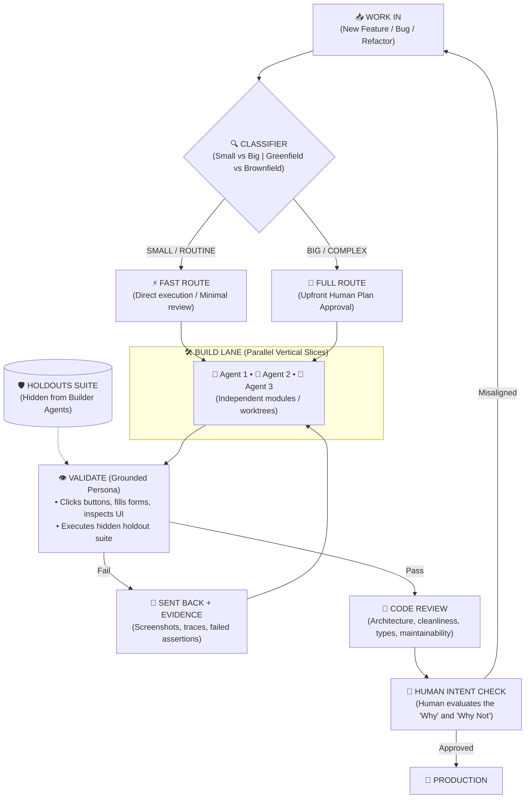

# Kem Glitch AI Development Methodology: The 6-Phase Lifecycle

Synthesized directly from **Kem Glitch** (Glitch Cat Club; Reel `DemLMidtxxj` — *"How I Develop with AI (High Level)"*).

---

## 🏛️ Executive Philosophy: "Code Decides, Humans Govern Intent"

Kem’s production engineering stack rests on four unbending rules:
1. **Deterministic Skills + Calibrated Probabilistic Judgment:** A skill is a blend of instructions the LLM follows and deterministic executable code. Code decides wherever it can. Where judgment is mandatory, use the calibrated local decision model (`h2o-lightning-4b` on `:8083`) through `jev-decision`.
2. **Humans Retain the "Why and Why Not":** Models are brilliant builders, but they naturally drift away from business intent and constraints. The human approves the plan upfront and validates intent at the finish line.
3. **Anti-Sycophancy via Holdouts:** Builders that see their own test suite optimize purely to cheat the tests. Holdout scenarios are withheld in an isolated folder until the build phase completes.
4. **Validation Comes Before Code Review:** Test the product like a real human user first (clicking, typing, inspecting live screens). Check whether the code is neat and maintainable only after it is proven to work.

---

## 🔁 The Lifecycle Flow

---

## 🛠️ Mechanisms in Detail

### 1. Upfront Routing & Classification
* **Fast Route:** Small bug fixes, standalone script additions, isolated docs. Run directly without committee bloat.
* **Full Route:** Architecture redesigns, database migrations, multi-module features. Requires explicit human sign-off on `plan.md` before code is generated.

### 2. Parallel Vertical Slices
* Divide multi-part work into vertical slices (API, UI, Database, Tests) rather than horizontal layers.
* Dispatch parallel subagents via `worktree-harness` so files don't conflict.

### 3. Holdout Scenarios (Anti-Sycophancy Invariant)
* If builder agents have access to tests during development, they write sycophantic code that specifically games the test assertions without solving the underlying problem.
* Holdouts are isolated in `.kem-loop/<run>/holdouts/` and run only during validation.

### 4. Grounded Persona Validation
* Give the model human sensory tools (high-speed browser CDP, screen readers, terminal PTYs) to click buttons, fill forms, and observe responses.
* When validation fails, emit hard evidence (logs, traces, screenshots) back to the builder.

### 5. Decoupled Code Review
* Cleanliness, linting, and type checking run strictly *after* functional validation passes.
* Clean code that fails functionally is still broken code.

### 6. No Adversarial Death Loops
* Never configure infinite critique-revise loops between models. Always enforce tight iteration limits and clean exit criteria.
